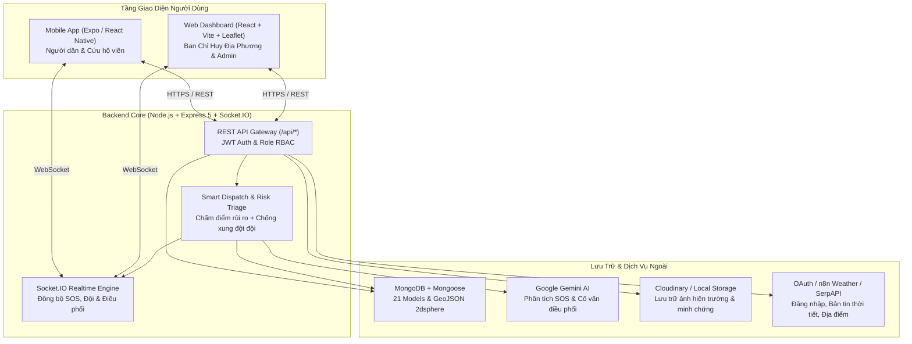
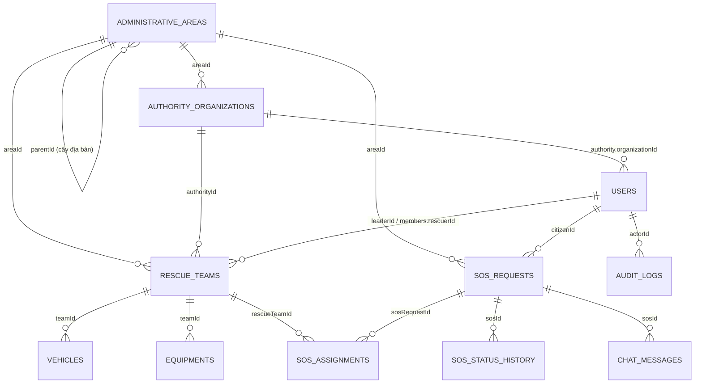

<<<<<<< HEAD
# SOS_SYSTEMS
# SOS_SYSTEMS
ĐẶC TẢ DATABASE & CHỨC NĂNG HỆ THỐNG
Công nghệ
Node.js
Express.js
MongoDB
Mongoose
TypeScript

1. Kiến trúc Database
MongoDB gồm 13 collections:
users
authority_organizations
administrative_areas
rescue_teams
vehicles
sos_requests
sos_assignments
sos_status_history
safe_locations
alerts
notifications
files
audit_logs
Không tạo riêng
citizen_profiles
rescuer_profiles
authority_profiles
team_members
Thông tin của Citizen / Rescuer / Local Authority được embedded trực tiếp trong users.

2. Users
Model
users
Schema
users
├── _id
├── phone
├── email
├── passwordHash
│
├── fullName
├── dateOfBirth
├── gender
├── address
├── avatarUrl
│
├── roles[]
├── status
├── isVerified
│
├── citizen
│   └── emergencyContact
│       ├── name
│       ├── phone
│       └── relation
│
├── rescuer
│   ├── idNumber
│   ├── skills[]
│   ├── experience
│   ├── vehicleType
│   ├── areaId
│   ├── verificationStatus
│   └── availabilityStatus
│
├── authority
│   ├── organizationId
│   ├── areaId
│   ├── position
│   └── department
│
├── lastLoginAt
├── createdAt
└── updatedAt
Thông tin chung User
Các trường sau thuộc trực tiếp users và dùng chung cho User:
fullName
dateOfBirth
gender
address
avatarUrl
gender:
MALE
FEMALE
OTHER

roles
roles là array.
Cho phép:
CITIZEN
RESCUER
LOCAL_AUTHORITY
ADMIN
Một User có thể có nhiều role.

status
ACTIVE
INACTIVE
SUSPENDED
PENDING

citizen
Chỉ chứa thông tin đặc thù của Citizen.
citizen:
└── emergencyContact:
    ├── name
    ├── phone
    └── relation
Emergency Contact
name
phone
relation


rescuer
rescuer:
├── idNumber
├── skills[]
├── experience
├── vehicleType
├── areaId
├── verificationStatus
└── availabilityStatus
verificationStatus
PENDING
VERIFIED
REJECTED
availabilityStatus
OFFLINE
AVAILABLE
BUSY
ON_MISSION
SUSPENDED
vehicleType
BOAT
AMBULANCE
TRUCK
MOTORBIKE
OTHER
References
rescuer.areaId → administrative_areas

authority
authority:
├── organizationId
├── areaId
├── position
└── department
References
organizationId → authority_organizations
areaId         → administrative_areas

3. Authority Organizations
Model
authority_local_organizations
Schema
_id
name
type
code
areaId
address
phone
email
status
createdAt
updatedAt
type
PROVINCE
DISTRICT
WARD
RESCUE_CENTER
OTHER
Reference
areaId → administrative_areas

4. Administrative Areas
Model
areas
Schema
_id
name
code
type
parentId
boundary
status
createdAt
updatedAt
type
COUNTRY
PROVINCE
DISTRICT
WARD
parentId
Reference tới chính collection:
parentId → administrative_areas
Dùng để tạo cây:
Vietnam
└── Da Nang
    ├── Phuong X
    ├── Phuong Y
    └── Phuong Z
boundary
Sử dụng GeoJSON Polygon:
{
  "type": "Polygon",
  "coordinates": []
}
Có thể tạo:
2dsphere index
cho boundary.

5. Rescue Teams
Model
rescue_teams
Schema
_id
name
type
leaderId
authorityId
areaId
members[]
description
status
createdAt
updatedAt
members
Embedded array:
members: [
  {
    rescuerId
    role
    joinedAt
  }
]
References
rescuerId → users
leaderId → users
authorityId → authority_organizations
areaId → administrative_areas
role
LEADER
MEMBER
type
FLOOD_RESCUE
FIRE_RESCUE
MEDICAL_RESCUE
SEARCH_RESCUE
GENERAL_RESCUE
OTHER
status
ACTIVE
INACTIVE
SUSPENDED
Không tạo team_members.

6. Vehicles
Model
vehicles
Schema
_id
teamId
type
plateNumber
capacity
status
description
createdAt
updatedAt
Reference
teamId → rescue_teams
type
BOAT
AMBULANCE
TRUCK
MOTORBIKE
OTHER
status
AVAILABLE
IN_USE
MAINTENANCE
INACTIVE

7. SOS Requests
Model
sos_requests
Schema
_id
sosCode
citizenId
location
areaId
address 
emergencyType
priority
people
description
status
createdAt
updatedAt
resolvedAt
citizenId
citizenId → users
citizenId chính là _id của User có role CITIZEN.

location
Bắt buộc sử dụng GeoJSON Point:
{
  "type": "Point",
  "coordinates": [longitude, latitude]
}
Tạo:
2dsphere index
cho location.
areaId
areaId → administrative_areas
emergencyType
FLOOD
FIRE
LANDSLIDE
STORM
ACCIDENT
MEDICAL
MISSING_PERSON
OTHER
priority
LOW
MEDIUM
HIGH
CRITICAL
status
PENDING
VERIFIED
ASSIGNED
ACCEPTED
ON_THE_WAY
ARRIVED
RESCUING
COMPLETED
CANCELLED
REJECTED
createdAt, updatedAt sử dụng:
timestamps: true

8. SOS Assignments
Model
sos_assignments
Schema
_id
sosId
teamId
rescuerId
vehicleId
assignedBy
route
status
assignedAt
acceptedAt
arrivedAt
completedAt
note
createdAt
updatedAt
References
sosId       → sos_requests
teamId      → rescue_teams
rescuerId   → users
vehicleId   → vehicles
assignedBy  → users
route
Embedded:
route:
├── distance
├── duration
└── geometry
distance: mét
duration: giây
geometry
GeoJSON LineString:
{
  "type": "LineString",
  "coordinates": []
}
status
ASSIGNED
ACCEPTED
ON_THE_WAY
ARRIVED
RESCUING
COMPLETED
CANCELLED

9. SOS Status History
Model
sos_status_history
Schema
_id
sosId
oldStatus
newStatus
changedBy
note
createdAt
References
sosId → sos_requests
changedBy → users
Không có updatedAt.
Đây là immutable audit history:
CREATE → được phép
UPDATE → không được phép
DELETE → không được phép
Chỉ tạo record mới khi trạng thái SOS thay đổi.

10. Safe Locations
Model
safe_locations
Schema
_id
name
type
location
areaId
address
capacity
currentOccupancy
status
createdBy
createdAt
updatedAt
References
areaId → administrative_areas
createdBy → users
location
GeoJSON Point:
{
  "type": "Point",
  "coordinates": [longitude, latitude]
}
Tạo 2dsphere index.
type
EVACUATION_CENTER
HOSPITAL
RESCUE_STATION
SHELTER
MEETING_POINT
status
ACTIVE
INACTIVE
FULL
MAINTENANCE

11. Alerts
Model
alerts
Schema
_id
createdBy
areaId
title
content
type
severity
targetArea
startTime
endTime
isActive
createdAt
updatedAt
References
createdBy → users
areaId → administrative_areas
type
FLOOD
LANDSLIDE
STORM
FIRE
DANGEROUS_AREA
OTHER
severity
LOW
MEDIUM
HIGH
CRITICAL
targetArea nên sử dụng reference tới administrative_areas để tránh duplicate dữ liệu.

12. Notifications
Model
notifications
Schema
_id
userId
sosId
type
title
content
data
isRead
createdAt
References
userId → users
sosId → sos_requests
sosId có thể null nếu notification không liên quan đến SOS.
data
Sử dụng:
Schema.Types.Mixed
Ví dụ:
{
  "assignmentId": "...",
  "teamId": "...",
  "status": "ACCEPTED"
}

13. Files
Model
files
Schema
_id
sosId
uploadedBy
type
url
fileName
fileSize
createdAt
References
sosId → sos_requests
uploadedBy → users
type
IMAGE
VIDEO
DOCUMENT
OTHER
File thực tế không lưu trong MongoDB.
MongoDB chỉ lưu:
url
fileName
fileSize
Storage có thể sử dụng:
Cloudinary
hoặc
S3

14. Audit Logs
Model
audit_logs
Schema
_id
actorId
actorRole
action
entityType
entityId
metadata
createdAt
Reference
actorId → users
metadata
Sử dụng:
Schema.Types.Mixed
Ví dụ:
{
  "oldStatus": "PENDING",
  "newStatus": "VERIFIED",
  "reason": "Valid emergency"
}
Không cần updatedAt.

15. Quan hệ chính giữa các Collection
users
 │
 ├── citizen
 │
 ├── rescuer
 │
 └── authority
       │
       ├──────────────→ authority_organizations
       │
       └──────────────→ administrative_areas
users
 │
 ├──→ sos_requests
 │         │
 │         ├──→ sos_assignments
 │         │        ├──→ rescue_teams
 │         │        ├──→ vehicles
 │         │        └──→ users
 │         │
 │         ├──→ sos_status_history
 │         └──→ files
 │
 ├──→ rescue_teams
 ├──→ safe_locations
 ├──→ alerts
 ├──→ notifications
 └──→ audit_logs

16. Socket.IO + Redis
Socket.IO không phải database.
Dùng để truyền dữ liệu realtime:
Rescuer App
     │
     │ GPS
     ▼
  Node.js
     │
     ├──→ Redis
     │      └── current GPS
     │
     └──→ Socket.IO
             │
             ├──→ Citizen
             │
             └──→ Authority
Redis dùng cho dữ liệu realtime/tạm thời như:
current GPS
online/offline
heartbeat
MongoDB lưu dữ liệu nghiệp vụ lâu dài.

17. Chức năng của Citizen
👤 Citizen
Chức năng
Collection / Service
Đăng ký/đăng nhập
users
Quản lý profile
users
Chỉnh sửa họ tên
users.fullName
Chỉnh sửa ngày sinh
users.dateOfBirth
Chỉnh sửa giới tính
users.gender
Chỉnh sửa địa chỉ
users.address
Chỉnh sửa avatar
users.avatarUrl
Quản lý người liên hệ khẩn cấp
users.citizen.emergencyContact
Gửi SOS
sos_requests
Gửi vị trí SOS
sos_requests
Upload ảnh/video
files
Theo dõi SOS
sos_requests
Xem trạng thái cứu hộ
sos_status_history
Xem cứu hộ được giao
sos_assignments
Xem route
sos_assignments
Xem vị trí rescuer realtime
Redis + Socket.IO
Gọi rescuer
App tel:
Gọi chính quyền
App tel:
Xem điểm sơ tán
safe_locations
Xem cảnh báo
alerts
Nhận thông báo
notifications
Xác nhận đã được cứu
sos_requests


18. Chức năng của Rescuer
🚑 Rescuer
Chức năng
Collection / Service
Đăng ký
users
Quản lý profile chung
users
Quản lý thông tin rescuer
users.rescuer
Khai báo kỹ năng
users.rescuer.skills
Khai báo kinh nghiệm
users.rescuer.experience
Khai báo phương tiện
users.rescuer.vehicleType
Khai báo khu vực
users.rescuer.areaId
Chờ xác minh
users.rescuer.verificationStatus
Online/Offline
Redis
Gửi heartbeat
Redis
Gửi GPS realtime
Redis + Socket.IO
Xem SOS
sos_requests
Xem nhiệm vụ
sos_assignments
Chấp nhận nhiệm vụ
sos_assignments
Xem route
sos_assignments
Điều hướng
Routing API
Cập nhật trạng thái
sos_requests + sos_status_history
Gọi người dân
App tel:
Gọi chính quyền
App tel:
Báo cáo kết quả
sos_assignments
Xem lịch sử nhiệm vụ
sos_assignments
Xem cảnh báo
alerts
Xem điểm an toàn
safe_locations


19. Chức năng của Local Authority
🏢 Local Authority
Đây là role điều phối chính.
Chức năng
Collection / Service
Đăng nhập
users
Quản lý profile
users
Quản lý thông tin authority
users.authority
Xem SOS trên bản đồ
sos_requests
Xem vị trí SOS
sos_requests
Xác minh SOS
sos_requests
Phân loại priority
sos_requests
Phân công rescuer
sos_assignments
Phân công team
sos_assignments
Chọn vehicle
vehicles
Xem rescuer realtime
Redis + Socket.IO
Theo dõi route
sos_assignments
Theo dõi tiến độ
sos_requests
Reassign nhiệm vụ
sos_assignments
Quản lý rescue team
rescue_teams
Thêm/xóa member
rescue_teams.members[]
Quản lý vehicle
vehicles
Quản lý điểm sơ tán
safe_locations
Tạo cảnh báo
alerts
Gửi thông báo
notifications
Gọi citizen
tel:
Gọi rescuer
tel:
Xem thống kê cứu hộ
MongoDB


20. Chức năng của Admin
Admin
Admin quản lý toàn platform, không trực tiếp xử lý từng SOS.
Chức năng
Collection
Quản lý users
users
Khóa/mở tài khoản
users
Quản lý thông tin Citizen
users.citizen
Quản lý thông tin Rescuer
users.rescuer
Xác minh Rescuer
users.rescuer.verificationStatus
Quản lý Rescuer
users.rescuer
Quản lý Authority
users.authority
Quản lý rescue team
rescue_teams
Quản lý team member
rescue_teams.members[]
Quản lý vehicle
vehicles
Xem toàn bộ SOS
sos_requests
Xem assignment
sos_assignments
Xem lịch sử trạng thái
sos_status_history
Quản lý safe location
safe_locations
Quản lý alert
alerts
Xem notification
notifications
Quản lý files
files
Xem audit logs
audit_logs
Thống kê hệ thống
MongoDB


=======
<div align="center">

# 🚨 RescueSOS (SOS_SYSTEMS)
### Hệ Thống Điều Phối Cứu Hộ Khẩn Cấp & Quản Trị Địa Bàn Thông Minh

[](https://expressjs.com/)
[](https://www.mongodb.com/)
[](https://react.dev/)
[](https://expo.dev/)
[](https://socket.io/)
[](https://www.typescriptlang.org/)

*Nền tảng kết nối **Người dân – Lực lượng cứu hộ – Ban Chỉ Huy PCTT & TKCN** theo thời gian thực, hỗ trợ định vị không gian địa lý (GeoJSON `2dsphere`), phân loại mức độ khẩn cấp đa tầng tích hợp AI (Google Gemini) và điều phối đa đội trực quan trên bản đồ số.*

</div>

---

## 📑 Mục lục

- [1. Giới thiệu bài toán](#-1-giới-thiệu-bài-toán)
- [2. Kiến trúc tổng thể hệ thống](#-2-kiến-trúc-tổng-thể-hệ-thống)
- [3. Công nghệ sử dụng](#-3-công-nghệ-sử-dụng)
- [4. Các phân hệ & Chức năng chính](#-4-các-phân-hệ--chức-năng-chính)
- [5. Thiết kế cơ sở dữ liệu](#-5-thiết-kế-cơ-sở-dữ-liệu)
- [6. Cấu trúc thư mục dự án](#-6-cấu-trúc-thư-mục-dự-án)
- [7. Hệ thống API & Sự kiện Realtime](#-7-hệ-thống-api--sự-kiện-realtime)
- [8. Hướng dẫn cài đặt & Khởi chạy](#-8-hướng-dẫn-cài-đặt--khởi-chạy)
- [9. Thông tin đồ án](#-9-thông-tin-đồ-án)

---

## 🎯 1. Giới thiệu bài toán

Trong các tình huống thiên tai (bão, ngập lụt, sạt lở đất) và sự cố khẩn cấp tại địa phương, việc tiếp nhận tin báo rời rạc qua điện thoại hoặc mạng xã hội thường gây chậm trễ, trùng lặp yêu cầu và khó phân bổ đúng đội cứu hộ có phương tiện phù hợp địa hình.

**RescueSOS (`SOS_SYSTEMS`)** được xây dựng nhằm số hóa khép kín quy trình ứng cứu từ lúc phát tín hiệu đến khi đưa nạn nhân về nơi an toàn:

- **Người dân (`CITIZEN`)**: Gửi tín hiệu SOS kèm tọa độ GPS, ảnh hiện trường, số người gặp nạn và nhóm đối tượng ưu tiên (trẻ sơ sinh, người cao tuổi, phụ nữ mang thai, người khuyết tật); theo dõi trạng thái đội ứng cứu trực tiếp và tra cứu điểm trú ẩn / vùng nguy hiểm.
- **Lực lượng cứu hộ (`RESCUER`)**: Quản lý trạng thái sẵn sàng tác chiến, tiếp nhận lệnh điều động theo đội, cập nhật tiến trình tại hiện trường (`ACCEPTED` -> `ON_THE_WAY` -> `ARRIVED` -> `RESCUING` -> `COMPLETED`), gửi yêu cầu xe đường bộ đón bờ (`Shore Handoff`) và xin chi viện vật tư.
- **Cán bộ địa phương (`LOCAL_AUTHORITY`) & Quản trị viên (`ADMIN`)**: Giám sát toàn bộ sự cố trên bản đồ tác chiến theo phạm vi hành chính, xác minh phân loại SOS với gợi ý AI, điều phối một hoặc nhiều đội cứu hộ (`Smart Dispatch`), quản lý đội/phương tiện/kho vật tư và điều hành công tác cộng đồng (kiểm tra an toàn, hiến máu, cảnh báo thời tiết).

---

## 🏗 2. Kiến trúc tổng thể hệ thống

Hệ thống tuân theo kiến trúc **Client – Server – Realtime Event-Driven** gồm 2 ứng dụng Client (`web` và `app`), 1 tầng API/Socket trung tâm (`backend`) và cơ sở dữ liệu MongoDB có chỉ mục không gian địa lý `2dsphere`.



---

## 🛠 3. Công nghệ sử dụng

| Thành phần | Công nghệ & Thư viện chính | Vai trò trong hệ thống |
| :--- | :--- | :--- |
| **Backend Server** | Node.js, Express `^5.2.1`, Socket.IO `^4.8.4` | RESTful API Gateway, RBAC phân quyền theo vai trò, truyền tải sự kiện thời gian thực |
| **Database** | MongoDB, Mongoose `^9.10.2` | Lưu trữ dữ liệu nghiệp vụ & truy vấn không gian địa lý GeoJSON (`2dsphere`) |
| **Xác thực & Bảo mật** | `jsonwebtoken`, `bcryptjs`, `google-auth-library`, `express-rate-limit`, `cookie-parser` | Đăng nhập JWT Access/Refresh Token, Google OAuth, giới hạn tần suất request |
| **Lưu trữ & Truyền thông** | `cloudinary`, `multer`, `multer-storage-cloudinary`, `nodemailer` | Tải ảnh hiện trường/minh chứng cứu hộ, gửi email thông báo & OTP |
| **Web Portal (`web/`)** | React `^19.2.8`, TypeScript `~6.0.2`, Vite `^8.3.0`, Leaflet `^1.9.4`, `react-leaflet` `^5.0.0`, `lucide-react`, `bootstrap-icons`, `socket.io-client` | Cổng tác chiến bản đồ cho Ban Chỉ Huy địa phương & Admin |
| **Mobile App (`app/`)** | React Native `0.88.0`, Expo `~58.0.19`, TypeScript `~6.0.3`, `react-native-maps`, `expo-location`, `expo-notifications`, `expo-camera`, `expo-image-picker`, `@supabase/supabase-js` | Ứng dụng thực địa cho Người dân & Cứu hộ viên |
| **AI & Tự động hóa** | Google Gemini (`gemini.service.js`), `n8n` Webhook (`n8nWeatherWorkflow.service.js`), `osmtogeojson` | Phân tích độ khẩn cấp từ mô tả/ảnh SOS, cố vấn chọn đội, đồng bộ bài viết thời tiết |

---

## ✨ 4. Các phân hệ & Chức năng chính

### 📱 A. Ứng dụng Di động (`app/` — Người dân & Cứu hộ viên)
- **Gửi yêu cầu SOS nhanh (`app/src/features/sos/`)**:
  - Tự động lấy tọa độ GPS, nhận diện khu vực hành chính, cho phép đính kèm ảnh hiện trường, chọn loại sự cố (`FLOOD`, `MEDICAL`, `FIRE`, `LANDSLIDE`, `STORM`, ...), số người cần cứu và đối tượng ưu tiên.
  - Chống spam trùng lặp trong bán kính `< 50m` và giới hạn an toàn số ca mở đồng thời; hỗ trợ gửi báo hộ người thân ở vị trí khác.
- **Bản đồ cứu trợ & An toàn (`app/src/features/map/`, `app/src/features/home/`)**:
  - Hiển thị điểm trú ẩn an toàn (`SafeLocation`), điểm cảnh báo nguy hiểm (`HazardReport`), bản tin thời tiết (`WeatherArticle`), chiến dịch hiến máu (`BloodDonationEvent`) và phản hồi kiểm tra an toàn (`SafetyCheck`: *An toàn* / *Cần hỗ trợ khẩn cấp*).
- **Tác chiến Cứu hộ viên (`app/src/features/mission/`, `app/src/features/profile/`)**:
  - Đăng ký hồ sơ năng lực cứu hộ (CCCD, kỹ năng, loại phương tiện, địa bàn phụ trách) để cơ quan chức năng xét duyệt (`PENDING` -> `VERIFIED`).
  - Bật/tắt trạng thái **Sẵn sàng nhận lệnh (`AVAILABLE` / `OFFLINE`)**, quản lý thành viên đội cứu hộ, nhận thông báo điều động kèm âm thanh cảnh báo.
  - Cập nhật trạng thái nhiệm vụ từng bước, chụp ảnh minh chứng hoàn thành, gửi yêu cầu xe đường bộ đón bờ (`Shore Handoff`) và xin chi viện vật tư thực địa.
  - **Cơ chế an toàn đội trưởng**: Khi đội trưởng của một đội gửi SOS, hệ thống tự động chuyển đội đó sang trạng thái không hoạt động (`INACTIVE`) để tránh điều nhầm chính đội trưởng đang gặp nạn, và tự động khôi phục về `ACTIVE / READY` khi đội trưởng hủy/hoàn thành SOS đó hoặc bật lại trạng thái sẵn sàng.

### 🖥️ B. Cổng Quản Trị & Điều Hành Tác Chiến Web (`web/` — Cán bộ địa phương & Admin)
- **Bản đồ Tác chiến Thời gian thực (`web/src/features/map-operation/`)**:
  - Trực quan hóa toàn bộ ca SOS, đội cứu hộ, điểm trú ẩn, điểm nguy hiểm và ranh giới địa bàn trên bản đồ `Leaflet` (`AuthorPortal`, `AdminPortal`, `TacticalMap`).
  - Phân quyền chặt theo địa bàn: `LOCAL_AUTHORITY` chỉ giám sát & điều phối các ca trong phạm vi phường/quận được giao; `ADMIN` quản lý toàn địa bàn và hỗ trợ điều phối liên vùng.
- **Phân loại & Điều phối Thông minh (`DispatchWorkflow`, `smartDispatch.service.js`)**:
  - Tách bạch **2 tầng đánh giá SOS**: Tầng 1 chấm điểm rủi ro theo quy tắc nghiệp vụ (`sosTriage.service.js`) và Tầng 2 phân tích ngữ nghĩa + hình ảnh bằng **Google Gemini AI**.
  - Lọc và xếp hạng các đội cứu hộ sẵn sàng theo khoảng cách Haversine, sức chứa phương tiện, trang thiết bị mang theo, phát hiện xung đột tài nguyên đa ca và gợi ý phương án AI (đơn đội hoặc phối hợp đa đội).
  - Hỗ trợ đổi đội (`ReassignModal`), hủy điều động và điều xe cứu thương/xe tải tiếp vận tại điểm cập bờ (`Shore Handoff`).
- **Quản trị Nguồn lực & Cộng đồng (`web/src/features/`)**:
  - Quản lý SOS (`sos`), Đội & Cứu hộ viên (`rescuers`), Phương tiện & Kho vật tư (`resources`), Cơ quan địa phương (`authorities`), Địa bàn hành chính (`areas`), Điểm trú ẩn (`shelters`), Điểm nguy hiểm (`hazards`), Cảnh báo & Kiểm tra an toàn (`alerts`), Hiến máu (`blood-donations`), Tin thời tiết (`weather`), Trao đổi tác chiến (`chat`) và Nhật ký kiểm toán (`audit`).

---

## 🗄 5. Thiết kế cơ sở dữ liệu

Hệ thống sử dụng **MongoDB** thông qua **21 Mongoose Models** tại [`backend/src/models/`](backend/src/models/index.js), tận dụng **Embedded Documents** (cho hồ sơ `citizen`/`rescuer`/`authority` trong `users` và danh sách `members` trong `rescue_teams`) kết hợp **References** và chỉ mục không gian **`2dsphere`**.

### Sơ đồ quan hệ thực thể cốt lõi (ER Diagram)



### Danh mục Collections & Models trong `backend/src/models/`

| Nhóm nghiệp vụ | Model (`File`) | Vai trò chính |
| :--- | :--- | :--- |
| **Người dùng & Tổ chức** | `User`, `AuthorityOrganization`, `AdministrativeArea` | Tài khoản đa vai trò (`CITIZEN`, `RESCUER`, `LOCAL_AUTHORITY`, `ADMIN`), hồ sơ nhúng `citizen`/`rescuer`/`authority`, cây địa bàn & ranh giới GeoJSON `Polygon` |
| **Lực lượng & Hậu cần** | `RescueTeam`, `Vehicle`, `Equipment` | Đội cứu hộ (`leaderId`, `members[]`, `operationalStatus`, `autoDeactivatedByLeaderSos`, `autoDeactivatedSosIds`, `baseLocation`), phương tiện (`BOAT`, `AMBULANCE`, `TRUCK`, ...), vật tư kho/đội |
| **Nghiệp vụ SOS & Điều phối** | `SosRequest`, `SosAssignment`, `SosStatusHistory`, `File` | Yêu cầu SOS (`location` `2dsphere`, `priority`, `aiAssessment`, `riskScore`, `shoreHandoff`), lệnh điều động (`PRIMARY`/`SHORE_HANDOFF`/`RELIEF_DISPATCH`), lịch sử trạng thái, file minh chứng |
| **An toàn & Cộng đồng** | `SafeLocation`, `HazardReport`, `SafetyCheck`, `SafetyCheckResponse`, `BloodDonationEvent`, `BloodDonationRegistration`, `WeatherArticle` | Điểm trú ẩn sức chứa thực tế, báo cáo vùng ngập/sạt lở, chiến dịch kiểm tra an toàn, sự kiện hiến máu, bản tin thời tiết |
| **Giao tiếp & Giám sát** | `Notification`, `ChatMessage`, `AuditLog` | Thông báo đẩy/hệ thống, kênh trao đổi tác chiến, nhật ký kiểm toán mọi thao tác nhạy cảm |

---

## 📁 6. Cấu trúc thư mục dự án

```text
SOS_SYSTEMS/
├── package.json                  # Scripts điều phối nhanh Web & Backend ở thư mục gốc
├── README.md                     # Tài liệu tổng quan & đặc tả hệ thống
├── docs/                         # Tài liệu báo cáo & đặc tả kỹ thuật bổ sung
│
├── backend/                      # Máy chủ Node.js / Express 5 / Socket.IO
│   ├── .env.example              # Mẫu biến môi trường (Port, MongoDB, JWT, OAuth, n8n...)
│   ├── package.json              # Scripts dev, start & các script seed dữ liệu mẫu
│   └── src/
│       ├── app.js                # Khởi tạo Express, CORS, static /uploads & /api routes
│       ├── server.js             # Kết nối MongoDB, seed mặc định & khởi chạy HTTP/Socket server
│       ├── socket.js             # Cấu hình Socket.IO và các kênh sự kiện realtime
│       ├── config/               # Cấu hình dịch vụ ngoài (Cloudinary)
│       ├── controllers/          # Tầng xử lý HTTP Request / Response
│       ├── middlewares/          # Xác thực JWT, phân quyền RBAC, xử lý lỗi tập trung
│       ├── models/               # 21 Mongoose Schemas & Indexes
│       ├── routes/               # Định nghĩa các nhóm endpoint RESTful (/api/*)
│       ├── services/             # Logic nghiệp vụ (SOS, Smart Dispatch, Gemini AI, Team...)
│       ├── utils/                # Tiện ích (ApiError, Expo Push, geocode, helpers)
│       └── seed*.js              # Các script khởi tạo dữ liệu địa bàn, đội, xe, tài khoản mẫu
│
├── web/                          # Cổng Web Điều Hành & Quản Trị (React + Vite + Leaflet)
│   ├── .env.example              # Cấu hình VITE_BACKEND_URL & VITE_API_URL
│   └── src/
│       ├── features/
│       │   ├── admin/            # Quản trị hệ thống, người dùng & cấu hình
│       │   ├── alerts/           # Cảnh báo & đợt kiểm tra an toàn (Safety Check)
│       │   ├── areas/            # Quản lý địa bàn hành chính
│       │   ├── audit/            # Nhật ký kiểm toán hệ thống
│       │   ├── auth/             # Đăng nhập & phân quyền cổng Web
│       │   ├── authorities/      # Quản lý cơ quan / Ban Chỉ Huy địa phương
│       │   ├── blood-donations/  # Quản lý đợt hiến máu nhân đạo
│       │   ├── chat/             # Trao đổi tác chiến trực tuyến
│       │   ├── coordination/     # Điều phối tổng hợp
│       │   ├── hazards/          # Quản lý điểm nguy hiểm / sạt lở / ngập sâu
│       │   ├── map-operation/    # Bản đồ tác chiến, DispatchWorkflow, Shore Handoff
│       │   ├── rescuers/         # Duyệt cứu hộ viên & quản lý đội cứu hộ địa phương
│       │   ├── resources/        # Quản lý phương tiện & kho vật tư cứu hộ
│       │   ├── settings/         # Cài đặt tài khoản & hệ thống
│       │   ├── shelters/         # Quản lý điểm trú ẩn an toàn
│       │   ├── sos/              # Bảng tiếp nhận, lọc & xác minh yêu cầu SOS
│       │   └── weather/          # Quản lý bản tin cảnh báo thời tiết
│       └── types/                # Định nghĩa TypeScript Domain models
│
└── app/                          # Ứng dụng Di động (Expo / React Native)
    ├── .env.example              # Cấu hình EXPO_PUBLIC_API_URL, Supabase, Google OAuth
    └── src/
        ├── api/                  # Client gọi REST API Backend
        ├── components/           # UI dùng chung (BottomNav, FloatingActiveSosWidget...)
        ├── context/              # AuthContext, NotificationContext, Network/Theme Context
        ├── features/             # auth, home, map, mission, news, profile, sos
        ├── navigation/           # Điều hướng màn hình theo vai trò Citizen / Rescuer
        ├── services/             # Push notifications, SSE, âm thanh còi báo động
        └── utils/                # Phân loại thông báo & xử lý dữ liệu thực địa
```

---

## 🔌 7. Hệ thống API & Sự kiện Realtime

Backend phục vụ API dưới cả tiền tố `/api/*` và `/*` tại cổng mặc định `5000` (health check tại `GET /api/health`).

### Nhóm API chính (`backend/src/routes/index.js`)

| Tiền tố Endpoint | Mô tả nghiệp vụ |
| :--- | :--- |
| `/api/auth`, `/api/users` | Đăng ký, đăng nhập JWT/Google OAuth, hồ sơ cá nhân, liên hệ khẩn cấp |
| `/api/sos` | Tạo/cập nhật/hủy/xóa SOS, xác minh mức độ, gợi ý điều phối AI, tiếp vận bờ (`shore-handoff`) |
| `/api/sos-assignments` *(mount tại `/`)* | Điều động đội cứu hộ, nhận/cập nhật trạng thái nhiệm vụ, đổi đội, xin/duyệt cấp vật tư |
| `/api/rescuer`, `/api/rescue-teams` | Duyệt hồ sơ cứu hộ viên, bật/tắt trạng thái `AVAILABLE`/`OFFLINE`, quản lý đội & đội trưởng |
| `/api/vehicles`, `/api/equipments` | Quản lý phương tiện cứu hộ và trang thiết bị/vật tư |
| `/api/administrative-areas`, `/api/authority-organizations` | Cây địa bàn hành chính & danh sách Ban Chỉ Huy PCTT |
| `/api/safe-locations`, `/api/hazard-reports` | Quản lý điểm trú ẩn an toàn & báo cáo khu vực nguy hiểm |
| `/api/safety-checks`, `/api/blood-donations` | Đợt kiểm tra an toàn cộng đồng & sự kiện hiến máu |
| `/api/weather-notifications`, `/api/weather-articles`, `/api/notifications` | Bản tin thời tiết (`n8n`), thông báo hệ thống & đẩy thông báo di động |
| `/api/chat`, `/api/files`, `/api/audit-logs`, `/api/admin`, `/api/config` | Trao đổi tác chiến, tải file, nhật ký kiểm toán, thống kê quản trị |

### Một số sự kiện Socket.IO tiêu biểu
- `sos:sync` / `sos:updated` / `sos:status_changed`: Đồng bộ danh sách và trạng thái SOS tức thời giữa App và Web.
- `rescue_teams_updated`: Cập nhật trạng thái hoạt động của đội (`ACTIVE` / `INACTIVE`, `LEADER_SOS_DEACTIVATED`, `LEADER_SOS_RESTORED`).
- `assignment:created` / `assignment:status_updated` / `assignment:updated`: Thông báo lệnh điều phối mới và tiến trình thực địa của đội cứu hộ.
- `sos:shore_handoff_requested` / `sos:shore_handoff_assigned`: Cảnh báo điều xe đường bộ đón nạn nhân tại bến cập bờ.
- `assignment:supply_requested` / `assignment:supply_approved`: Yêu cầu và phê duyệt chi viện vật tư khẩn cấp.

---

## 🚀 8. Hướng dẫn cài đặt & Khởi chạy

### Yêu cầu môi trường
- **Node.js** `>= 20.x` và **npm**
- **MongoDB** (cài đặt cục bộ hoặc **MongoDB Atlas**)
- **Expo Go** trên điện thoại Android/iOS (hoặc Android Emulator / iOS Simulator) để chạy Mobile App

### Bước 1: Clone mã nguồn & Cài đặt dependencies

```bash
git clone https://github.com/HoangLuu217/SOS_SYSTEMS.git
cd SOS_SYSTEMS

# Cài đặt thư viện cho từng phân hệ
npm --prefix backend install
npm --prefix web install
npm --prefix app install
```

### Bước 2: Cấu hình biến môi trường

Tạo file `.env` từ các file mẫu `.env.example` ở cả 3 thư mục:

1. **Backend (`backend/.env` từ `backend/.env.example`)**:
   ```env
   PORT=5000
   MONGODB_URI=mongodb://localhost:27017/sos_systems
   JWT_SECRET=your_jwt_secret
   JWT_REFRESH_SECRET=your_jwt_refresh_secret
   CLIENT_URL=http://localhost:5173
   NODE_ENV=development
   # Tùy chọn nâng cao: GEMINI_API_KEY, CLOUDINARY_*, GOOGLE_CLIENT_ID, SUPABASE_*, FIREBASE_*, N8N_WEATHER_WEBHOOK_*
   ```
2. **Web (`web/.env` từ `web/.env.example`)**:
   ```env
   VITE_BACKEND_URL=http://localhost:5000
   VITE_API_URL=http://localhost:5000/api
   ```
3. **Mobile App (`app/.env` từ `app/.env.example`)**:
   ```env
   EXPO_PUBLIC_API_URL=http://<IP_MAY_TINH_TRONG_LAN>:5000/api
   ```
   > *Lưu ý: Khi test trên điện thoại thật qua Expo Go, thay `localhost` bằng địa chỉ IP LAN của máy đang chạy Backend (ví dụ `http://192.168.1.10:5000/api`).*

### Bước 3: Khởi tạo dữ liệu mẫu (Tùy chọn)

Trong thư mục `backend/`, dự án cung cấp sẵn các script seed dữ liệu (địa bàn, cơ quan, người dùng, đội & phương tiện):

```bash
cd backend
npm run seed            # Dữ liệu khởi tạo tổng quát
npm run seed:areas      # Cây địa bàn hành chính
npm run seed:authority  # Cơ quan Ban Chỉ Huy địa phương
npm run seed:teams      # Đội cứu hộ & phương tiện
npm run seed:users      # Tài khoản người dùng bổ sung
```

### Bước 4: Khởi chạy hệ thống

Mở 3 terminal riêng biệt (hoặc dùng script ở thư mục gốc cho Backend & Web):

```bash
# Terminal 1 - Chạy Backend API & Socket.IO (Port 5000)
npm run dev:backend

# Terminal 2 - Chạy Web Dashboard (Port 5173)
npm run dev:web

# Terminal 3 - Chạy Mobile App với Expo
npm --prefix app run start
# Hoặc chạy qua tunnel để test từ xa: npm --prefix app run tunnel
```

Sau khi khởi chạy thành công:
- **Backend API & Health Check**: `http://localhost:5000/api/health`
- **Web Dashboard**: `http://localhost:5173`
- **Mobile App**: Quét mã QR hiển thị trên terminal bằng ứng dụng **Expo Go**

---

## 🎓 9. Thông tin đồ án

| Hạng mục | Thông tin |
| :--- | :--- |
| **Tên đề tài** | Xây dựng hệ thống hỗ trợ tìm kiếm, điều phối cứu hộ khẩn cấp và quản trị địa bàn theo thời gian thực (**RescueSOS**) |
| **Kho lưu trữ** | [HoangLuu217/SOS_SYSTEMS](https://github.com/HoangLuu217/SOS_SYSTEMS) |
| **Giảng viên hướng dẫn** | *(Điền tên giảng viên hướng dẫn của bạn)* |
| **Sinh viên thực hiện** | *(Điền họ tên & MSSV nhóm sinh viên thực hiện)* |

---

<div align="center">
<sub>Được xây dựng phục vụ đồ án tốt nghiệp — Hệ thống Điều Phối Cứu Hộ Khẩn Cấp RescueSOS.</sub>
</div>
>>>>>>> 0e8e8e647be0644ca846be4177f1da1bed4fe1be
