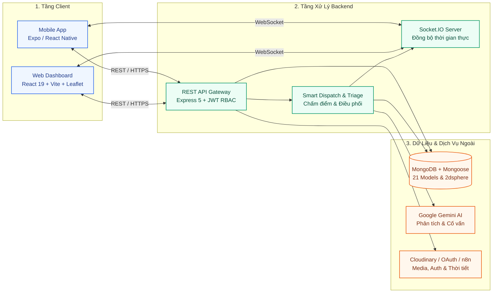
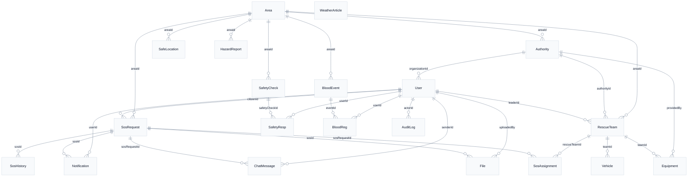

<div align="center">

# 🚨 Cứu Hộ Cứu Nạn
### Hệ Thống Điều Phối Cứu Hộ Khẩn Cấp & Quản Lý Địa Bàn

[](https://expressjs.com/)
[](https://www.mongodb.com/)
[](https://react.dev/)
[](https://expo.dev/)
[](https://socket.io/)
[](https://www.typescriptlang.org/)

*Nền tảng kết nối **Người dân – Lực lượng cứu hộ – Ban Chỉ Huy PCTT & TKCN** theo thời gian thực, hỗ trợ định vị không gian địa lý (GeoJSON `2dsphere`), phân loại mức độ khẩn cấp đa tầng tích hợp AI (Google Gemini) và điều phối đa đội trực quan trên bản đồ số.*

</div>

---

## 📑 Mục lục

- [1. Giới thiệu bài toán](#-1-giới-thiệu-bài-toán)
- [2. Kiến trúc tổng thể hệ thống](#-2-kiến-trúc-tổng-thể-hệ-thống)
- [3. Công nghệ sử dụng](#-3-công-nghệ-sử-dụng)
- [4. Các phân hệ & Chức năng chính](#-4-các-phân-hệ--chức-năng-chính)
- [5. Thiết kế cơ sở dữ liệu](#-5-thiết-kế-cơ-sở-dữ-liệu)
- [6. Cấu trúc thư mục dự án](#-6-cấu-trúc-thư-mục-dự-án)
- [7. Hệ thống API & Sự kiện Realtime](#-7-hệ-thống-api--sự-kiện-realtime)
- [8. Hướng dẫn cài đặt & Khởi chạy](#-8-hướng-dẫn-cài-đặt--khởi-chạy)

---

## 🎯 1. Giới thiệu bài toán

Trong các tình huống thiên tai (bão, ngập lụt, sạt lở đất) và sự cố khẩn cấp tại địa phương, việc tiếp nhận tin báo rời rạc qua điện thoại hoặc mạng xã hội thường gây chậm trễ, trùng lặp yêu cầu và khó phân bổ đúng đội cứu hộ có phương tiện phù hợp địa hình.

**RescueSOS (`SOS_SYSTEMS`)** được xây dựng nhằm số hóa khép kín quy trình ứng cứu từ lúc phát tín hiệu đến khi đưa nạn nhân về nơi an toàn:

- **Người dân (`CITIZEN`)**: Gửi tín hiệu SOS kèm tọa độ GPS, ảnh hiện trường, số người gặp nạn và nhóm đối tượng ưu tiên (trẻ sơ sinh, người cao tuổi, phụ nữ mang thai, người khuyết tật); theo dõi trạng thái đội ứng cứu trực tiếp và tra cứu điểm trú ẩn / vùng nguy hiểm.
- **Lực lượng cứu hộ (`RESCUER`)**: Quản lý trạng thái sẵn sàng tác chiến, tiếp nhận lệnh điều động theo đội, cập nhật tiến trình tại hiện trường (`ACCEPTED` -> `ON_THE_WAY` -> `ARRIVED` -> `RESCUING` -> `COMPLETED`), gửi yêu cầu xe đường bộ đón bờ (`Shore Handoff`) và xin chi viện vật tư.
- **Cán bộ địa phương (`LOCAL_AUTHORITY`) & Quản trị viên (`ADMIN`)**: Giám sát toàn bộ sự cố trên bản đồ tác chiến theo phạm vi hành chính, xác minh phân loại SOS với gợi ý AI, điều phối một hoặc nhiều đội cứu hộ (`Smart Dispatch`), quản lý đội/phương tiện/kho vật tư và điều hành công tác cộng đồng (kiểm tra an toàn, hiến máu, cảnh báo thời tiết).

---

## 🏗 2. Kiến trúc tổng thể hệ thống

Hệ thống tuân theo kiến trúc **Client – Server – Realtime Event-Driven** gồm 2 ứng dụng Client (`web` và `app`), 1 tầng API/Socket trung tâm (`backend`) và cơ sở dữ liệu MongoDB có chỉ mục không gian địa lý `2dsphere`.



---

## 🛠 3. Công nghệ sử dụng

| Thành phần | Công nghệ & Thư viện chính | Vai trò trong hệ thống |
| :--- | :--- | :--- |
| **Backend Server** | Node.js, Express `^5.2.1`, Socket.IO `^4.8.4` | RESTful API Gateway, RBAC phân quyền theo vai trò, truyền tải sự kiện thời gian thực |
| **Database** | MongoDB, Mongoose `^9.10.2` | Lưu trữ dữ liệu nghiệp vụ & truy vấn không gian địa lý GeoJSON (`2dsphere`) |
| **Xác thực & Bảo mật** | `jsonwebtoken`, `bcryptjs`, `google-auth-library`, `express-rate-limit`, `cookie-parser` | Đăng nhập JWT Access/Refresh Token, Google OAuth, giới hạn tần suất request |
| **Lưu trữ & Truyền thông** | `cloudinary`, `multer`, `multer-storage-cloudinary`, `nodemailer` | Tải ảnh hiện trường/minh chứng cứu hộ, gửi email thông báo & OTP |
| **Web Portal (`web/`)** | React `^19.2.8`, TypeScript `~6.0.2`, Vite `^8.3.0`, Leaflet `^1.9.4`, `react-leaflet` `^5.0.0`, `lucide-react`, `bootstrap-icons`, `socket.io-client` | Cổng tác chiến bản đồ cho Ban Chỉ Huy địa phương & Admin |
| **Mobile App (`app/`)** | React Native `0.88.0`, Expo `~58.0.19`, TypeScript `~6.0.3`, `react-native-maps`, `expo-location`, `expo-notifications`, `expo-camera`, `expo-image-picker`, `@supabase/supabase-js` | Ứng dụng thực địa cho Người dân & Cứu hộ viên |
| **AI & Tự động hóa** | Google Gemini (`gemini.service.js`), `n8n` Webhook (`n8nWeatherWorkflow.service.js`), `osmtogeojson` | Phân tích độ khẩn cấp từ mô tả/ảnh SOS, cố vấn chọn đội, đồng bộ bài viết thời tiết |

---

## ✨ 4. Các phân hệ & Chức năng chính

### 📱 A. Ứng dụng Di động (`app/` — Người dân & Cứu hộ viên)
- **Gửi yêu cầu SOS nhanh (`app/src/features/sos/`)**:
  - Tự động lấy tọa độ GPS, nhận diện khu vực hành chính, cho phép đính kèm ảnh hiện trường, chọn loại sự cố (`FLOOD`, `MEDICAL`, `FIRE`, `LANDSLIDE`, `STORM`, ...), số người cần cứu và đối tượng ưu tiên.
  - Chống spam trùng lặp trong bán kính `< 50m` và giới hạn an toàn số ca mở đồng thời; hỗ trợ gửi báo hộ người thân ở vị trí khác.
- **Bản đồ cứu trợ & An toàn (`app/src/features/map/`, `app/src/features/home/`)**:
  - Hiển thị điểm trú ẩn an toàn (`SafeLocation`), điểm cảnh báo nguy hiểm (`HazardReport`), bản tin thời tiết (`WeatherArticle`), chiến dịch hiến máu (`BloodDonationEvent`) và phản hồi kiểm tra an toàn (`SafetyCheck`: *An toàn* / *Cần hỗ trợ khẩn cấp*).
- **Tác chiến Cứu hộ viên (`app/src/features/mission/`, `app/src/features/profile/`)**:
  - Đăng ký hồ sơ năng lực cứu hộ (CCCD, kỹ năng, loại phương tiện, địa bàn phụ trách) để cơ quan chức năng xét duyệt (`PENDING` -> `VERIFIED`).
  - Bật/tắt trạng thái **Sẵn sàng nhận lệnh (`AVAILABLE` / `OFFLINE`)**, quản lý thành viên đội cứu hộ, nhận thông báo điều động kèm âm thanh cảnh báo.
  - Cập nhật trạng thái nhiệm vụ từng bước, chụp ảnh minh chứng hoàn thành, gửi yêu cầu xe đường bộ đón bờ (`Shore Handoff`) và xin chi viện vật tư thực địa.
  - **Cơ chế an toàn đội trưởng**: Khi đội trưởng của một đội gửi SOS, hệ thống tự động chuyển đội đó sang trạng thái không hoạt động (`INACTIVE`) để tránh điều nhầm chính đội trưởng đang gặp nạn, và tự động khôi phục về `ACTIVE / READY` khi đội trưởng hủy/hoàn thành SOS đó hoặc bật lại trạng thái sẵn sàng.

### 🖥️ B. Cổng Quản Trị & Điều Hành Tác Chiến Web (`web/` — Cán bộ địa phương & Admin)
- **Bản đồ Tác chiến Thời gian thực (`web/src/features/map-operation/`)**:
  - Trực quan hóa toàn bộ ca SOS, đội cứu hộ, điểm trú ẩn, điểm nguy hiểm và ranh giới địa bàn trên bản đồ `Leaflet` (`AuthorPortal`, `AdminPortal`, `TacticalMap`).
  - Phân quyền chặt theo địa bàn: `LOCAL_AUTHORITY` chỉ giám sát & điều phối các ca trong phạm vi phường/quận được giao; `ADMIN` quản lý toàn địa bàn và hỗ trợ điều phối liên vùng.
- **Phân loại & Điều phối Thông minh (`DispatchWorkflow`, `smartDispatch.service.js`)**:
  - Tách bạch **2 tầng đánh giá SOS**: Tầng 1 chấm điểm rủi ro theo quy tắc nghiệp vụ (`sosTriage.service.js`) và Tầng 2 phân tích ngữ nghĩa + hình ảnh bằng **Google Gemini AI**.
  - Lọc và xếp hạng các đội cứu hộ sẵn sàng theo khoảng cách Haversine, sức chứa phương tiện, trang thiết bị mang theo, phát hiện xung đột tài nguyên đa ca và gợi ý phương án AI (đơn đội hoặc phối hợp đa đội).
  - Hỗ trợ đổi đội (`ReassignModal`), hủy điều động và điều xe cứu thương/xe tải tiếp vận tại điểm cập bờ (`Shore Handoff`).
- **Quản trị Nguồn lực & Cộng đồng (`web/src/features/`)**:
  - Quản lý SOS (`sos`), Đội & Cứu hộ viên (`rescuers`), Phương tiện & Kho vật tư (`resources`), Cơ quan địa phương (`authorities`), Địa bàn hành chính (`areas`), Điểm trú ẩn (`shelters`), Điểm nguy hiểm (`hazards`), Cảnh báo & Kiểm tra an toàn (`alerts`), Hiến máu (`blood-donations`), Tin thời tiết (`weather`), Trao đổi tác chiến (`chat`) và Nhật ký kiểm toán (`audit`).

---

## 🗄 5. Thiết kế cơ sở dữ liệu

Hệ thống sử dụng **MongoDB** thông qua **21 Mongoose Models** tại [`backend/src/models/`](backend/src/models/index.js), tận dụng **Embedded Documents** (cho hồ sơ `citizen`/`rescuer`/`authority` trong `users` và danh sách `members` trong `rescue_teams`) kết hợp **References** và chỉ mục không gian **`2dsphere`**.

### Sơ đồ quan hệ thực thể toàn hệ thống (ER Diagram)



### Danh mục Collections & Models trong `backend/src/models/`

| Nhóm nghiệp vụ | Model (`File`) | Vai trò chính |
| :--- | :--- | :--- |
| **Người dùng & Tổ chức** | `User`, `AuthorityOrganization`, `AdministrativeArea` | Tài khoản đa vai trò (`CITIZEN`, `RESCUER`, `LOCAL_AUTHORITY`, `ADMIN`), hồ sơ nhúng `citizen`/`rescuer`/`authority`, cây địa bàn & ranh giới GeoJSON `Polygon` |
| **Lực lượng & Hậu cần** | `RescueTeam`, `Vehicle`, `Equipment` | Đội cứu hộ (`leaderId`, `members[]`, `operationalStatus`, `autoDeactivatedByLeaderSos`, `autoDeactivatedSosIds`, `baseLocation`), phương tiện (`BOAT`, `AMBULANCE`, `TRUCK`, ...), vật tư kho/đội |
| **Nghiệp vụ SOS & Điều phối** | `SosRequest`, `SosAssignment`, `SosStatusHistory`, `File` | Yêu cầu SOS (`location` `2dsphere`, `priority`, `aiAssessment`, `riskScore`, `shoreHandoff`), lệnh điều động (`SOS_RESCUE`/`RELIEF_DISPATCH`/`SHORE_HANDOFF`), lịch sử trạng thái, file minh chứng |
| **An toàn & Cộng đồng** | `SafeLocation`, `HazardReport`, `SafetyCheck`, `SafetyCheckResponse`, `BloodDonationEvent`, `BloodDonationRegistration`, `WeatherArticle` | Điểm trú ẩn sức chứa thực tế, báo cáo vùng ngập/sạt lở, chiến dịch kiểm tra an toàn, sự kiện hiến máu, bản tin thời tiết |
| **Giao tiếp & Giám sát** | `Notification`, `ChatMessage`, `AuditLog` | Thông báo đẩy/hệ thống, kênh trao đổi tác chiến, nhật ký kiểm toán mọi thao tác nhạy cảm |

---

## 📁 6. Cấu trúc thư mục dự án

```text
SOS_SYSTEMS/
├── package.json                  # Scripts điều phối nhanh Web & Backend ở thư mục gốc
├── README.md                     # Tài liệu tổng quan & đặc tả hệ thống
├── docs/                         # Tài liệu báo cáo & đặc tả kỹ thuật bổ sung
│
├── backend/                      # Máy chủ Node.js / Express 5 / Socket.IO
│   ├── .env.example              # Mẫu biến môi trường (Port, MongoDB, JWT, OAuth, n8n...)
│   ├── package.json              # Scripts dev, start & các script seed dữ liệu mẫu
│   └── src/
│       ├── app.js                # Khởi tạo Express, CORS, static /uploads & /api routes
│       ├── server.js             # Kết nối MongoDB, seed mặc định & khởi chạy HTTP/Socket server
│       ├── socket.js             # Cấu hình Socket.IO và các kênh sự kiện realtime
│       ├── config/               # Cấu hình dịch vụ ngoài (Cloudinary)
│       ├── controllers/          # Tầng xử lý HTTP Request / Response
│       ├── middlewares/          # Xác thực JWT, phân quyền RBAC, xử lý lỗi tập trung
│       ├── models/               # 21 Mongoose Schemas & Indexes
│       ├── routes/               # Định nghĩa các nhóm endpoint RESTful (/api/*)
│       ├── services/             # Logic nghiệp vụ (SOS, Smart Dispatch, Gemini AI, Team...)
│       ├── utils/                # Tiện ích (ApiError, Expo Push, geocode, helpers)
│       └── seed*.js              # Các script khởi tạo dữ liệu địa bàn, đội, xe, tài khoản mẫu
│
├── web/                          # Cổng Web Điều Hành & Quản Trị (React + Vite + Leaflet)
│   ├── .env.example              # Cấu hình VITE_BACKEND_URL & VITE_API_URL
│   └── src/
│       ├── features/
│       │   ├── admin/            # Quản trị hệ thống, người dùng & cấu hình
│       │   ├── alerts/           # Cảnh báo & đợt kiểm tra an toàn (Safety Check)
│       │   ├── areas/            # Quản lý địa bàn hành chính
│       │   ├── audit/            # Nhật ký kiểm toán hệ thống
│       │   ├── auth/             # Đăng nhập & phân quyền cổng Web
│       │   ├── authorities/      # Quản lý cơ quan / Ban Chỉ Huy địa phương
│       │   ├── blood-donations/  # Quản lý đợt hiến máu nhân đạo
│       │   ├── chat/             # Trao đổi tác chiến trực tuyến
│       │   ├── coordination/     # Điều phối tổng hợp
│       │   ├── hazards/          # Quản lý điểm nguy hiểm / sạt lở / ngập sâu
│       │   ├── map-operation/    # Bản đồ tác chiến, DispatchWorkflow, Shore Handoff
│       │   ├── rescuers/         # Duyệt cứu hộ viên & quản lý đội cứu hộ địa phương
│       │   ├── resources/        # Quản lý phương tiện & kho vật tư cứu hộ
│       │   ├── settings/         # Cài đặt tài khoản & hệ thống
│       │   ├── shelters/         # Quản lý điểm trú ẩn an toàn
│       │   ├── sos/              # Bảng tiếp nhận, lọc & xác minh yêu cầu SOS
│       │   └── weather/          # Quản lý bản tin cảnh báo thời tiết
│       └── types/                # Định nghĩa TypeScript Domain models
│
└── app/                          # Ứng dụng Di động (Expo / React Native)
    ├── .env.example              # Cấu hình EXPO_PUBLIC_API_URL, Supabase, Google OAuth
    └── src/
        ├── api/                  # Client gọi REST API Backend
        ├── components/           # UI dùng chung (BottomNav, FloatingActiveSosWidget...)
        ├── context/              # AuthContext, NotificationContext, Network/Theme Context
        ├── features/             # auth, home, map, mission, news, profile, sos
        ├── navigation/           # Điều hướng màn hình theo vai trò Citizen / Rescuer
        ├── services/             # Push notifications, SSE, âm thanh còi báo động
        └── utils/                # Phân loại thông báo & xử lý dữ liệu thực địa
```

---

## 🔌 7. Hệ thống API & Sự kiện Realtime

Backend phục vụ API dưới cả tiền tố `/api/*` và `/*` tại cổng mặc định `5000` (health check tại `GET /api/health`).

### Nhóm API chính (`backend/src/routes/index.js`)

| Tiền tố Endpoint | Mô tả nghiệp vụ |
| :--- | :--- |
| `/api/auth`, `/api/users` | Đăng ký, đăng nhập JWT/Google OAuth, hồ sơ cá nhân, liên hệ khẩn cấp |
| `/api/sos` | Tạo/cập nhật/hủy/xóa SOS, xác minh mức độ, gợi ý điều phối AI, tiếp vận bờ (`shore-handoff`) |
| `/api/sos-assignments` *(mount tại `/`)* | Điều động đội cứu hộ, nhận/cập nhật trạng thái nhiệm vụ, đổi đội, xin/duyệt cấp vật tư |
| `/api/rescuer`, `/api/rescue-teams` | Duyệt hồ sơ cứu hộ viên, bật/tắt trạng thái `AVAILABLE`/`OFFLINE`, quản lý đội & đội trưởng |
| `/api/vehicles`, `/api/equipments` | Quản lý phương tiện cứu hộ và trang thiết bị/vật tư |
| `/api/administrative-areas`, `/api/authority-organizations` | Cây địa bàn hành chính & danh sách Ban Chỉ Huy PCTT |
| `/api/safe-locations`, `/api/hazard-reports` | Quản lý điểm trú ẩn an toàn & báo cáo khu vực nguy hiểm |
| `/api/safety-checks`, `/api/blood-donations` | Đợt kiểm tra an toàn cộng đồng & sự kiện hiến máu |
| `/api/weather-notifications`, `/api/weather-articles`, `/api/notifications` | Bản tin thời tiết (`n8n`), thông báo hệ thống & đẩy thông báo di động |
| `/api/chat`, `/api/files`, `/api/audit-logs`, `/api/admin`, `/api/config` | Trao đổi tác chiến, tải file, nhật ký kiểm toán, thống kê quản trị |

### Một số sự kiện Socket.IO tiêu biểu
- `sos:sync` / `sos:updated` / `sos:status_changed`: Đồng bộ danh sách và trạng thái SOS tức thời giữa App và Web.
- `rescue_teams_updated`: Cập nhật trạng thái hoạt động của đội (`ACTIVE` / `INACTIVE`, `LEADER_SOS_DEACTIVATED`, `LEADER_SOS_RESTORED`).
- `assignment:created` / `assignment:status_updated` / `assignment:updated`: Thông báo lệnh điều phối mới và tiến trình thực địa của đội cứu hộ.
- `sos:shore_handoff_requested` / `sos:shore_handoff_assigned`: Cảnh báo điều xe đường bộ đón nạn nhân tại bến cập bờ.
- `assignment:supply_requested` / `assignment:supply_approved`: Yêu cầu và phê duyệt chi viện vật tư khẩn cấp.

---

## 🚀 8. Hướng dẫn cài đặt & Khởi chạy

### Triển khai production bằng Docker trên Linux + Cloudflare Tunnel

Frontend được phục vụ ở cổng `3000` trên localhost. Nginx trong container web proxy `/api` và `/socket.io` tới backend, vì vậy Cloudflare Tunnel chỉ cần một Public Hostname trỏ tới `http://localhost:3000`. Không mở cổng web hoặc API trực tiếp ra Internet.

1. Trên máy Linux, cài Docker Engine và Docker Compose plugin, clone repo rồi vào thư mục dự án.
2. Tạo `backend/.env` từ `backend/.env.example`. Đặt `NODE_ENV=production`, `PORT=5000`, các secret JWT dài và ngẫu nhiên, và `CLIENT_URL=https://<domain-cua-ban>`. Compose sẽ ghi đè `MONGODB_URI` để backend kết nối MongoDB container nội bộ (`mongodb://mongodb:27017/sos_systems`). Điền các khóa dịch vụ mà hệ thống sử dụng. Không dùng các secret mẫu trong `.env.example`.
3. Trong Cloudflare Zero Trust, cấu hình hostname cho Tunnel trỏ tới `http://localhost:3000` (hoặc địa chỉ Docker host phù hợp nếu Tunnel chạy trong container).
4. Khởi động tại thư mục repo:

   ```bash
   docker compose up -d --build
   docker compose ps
   docker compose logs -f
   ```

   Kiểm tra `http://localhost:3000/api/health` trên Linux và sau đó mở hostname HTTPS của bạn.

MongoDB lưu dữ liệu trong Docker volume `mongodb_data`, tồn tại qua các lần cập nhật container. Sao lưu volume này định kỳ. Dữ liệu hiện có trên Atlas không tự động được nhập vào MongoDB container.

Để cập nhật phiên bản, chạy `git pull` rồi `docker compose up -d --build`. Dữ liệu upload nằm trong `backend/uploads`; hãy sao lưu thư mục này nếu ứng dụng lưu file cục bộ. Nếu các file được lưu trên Cloudinary, cấu hình Cloudinary trong backend env và có thể bỏ qua lưu trữ ảnh cục bộ.

**Lưu ý:** URL web dùng `/api` và `/socket.io` cùng origin, nên không cần khai báo IP/domain public lúc build frontend. Mobile app là client riêng; khi phát hành app, đặt `EXPO_PUBLIC_API_URL` thành `https://<domain-cua-ban>/api` và build lại app.

### Yêu cầu môi trường
- **Node.js** `>= 20.x` và **npm**
- **MongoDB** (cài đặt cục bộ hoặc **MongoDB Atlas**)
- **Expo Go** trên điện thoại Android/iOS (hoặc Android Emulator / iOS Simulator) để chạy Mobile App

### Bước 1: Clone mã nguồn & Cài đặt dependencies

```bash
git clone https://github.com/HoangLuu217/SOS_SYSTEMS.git
cd SOS_SYSTEMS

# Cài đặt thư viện cho từng phân hệ
npm --prefix backend install
npm --prefix web install
npm --prefix app install
```

### Bước 2: Cấu hình biến môi trường

Tạo file `.env` từ các file mẫu `.env.example` ở cả 3 thư mục:

1. **Backend (`backend/.env` từ `backend/.env.example`)**:
   ```env
   PORT=5000
   MONGODB_URI=mongodb://localhost:27017/sos_systems
   JWT_SECRET=your_jwt_secret
   JWT_REFRESH_SECRET=your_jwt_refresh_secret
   CLIENT_URL=http://localhost:5173
   NODE_ENV=development
   # Tùy chọn nâng cao: GEMINI_API_KEY, CLOUDINARY_*, GOOGLE_CLIENT_ID, SUPABASE_*, FIREBASE_*, N8N_WEATHER_WEBHOOK_*
   ```
2. **Web (`web/.env` từ `web/.env.example`)**:
   ```env
   VITE_BACKEND_URL=http://localhost:5000
   VITE_API_URL=http://localhost:5000/api
   ```
3. **Mobile App (`app/.env` từ `app/.env.example`)**:
   ```env
   EXPO_PUBLIC_API_URL=http://<IP_MAY_TINH_TRONG_LAN>:5000/api
   ```
   > *Lưu ý: Khi test trên điện thoại thật qua Expo Go, thay `localhost` bằng địa chỉ IP LAN của máy đang chạy Backend (ví dụ `http://192.168.1.10:5000/api`).*

### Bước 3: Khởi tạo dữ liệu mẫu (Tùy chọn)

Trong thư mục `backend/`, dự án cung cấp sẵn các script seed dữ liệu (địa bàn, cơ quan, người dùng, đội & phương tiện):

```bash
cd backend
npm run seed            # Dữ liệu khởi tạo tổng quát
npm run seed:areas      # Cây địa bàn hành chính
npm run seed:authority  # Cơ quan Ban Chỉ Huy địa phương
npm run seed:teams      # Đội cứu hộ & phương tiện
npm run seed:users      # Tài khoản người dùng bổ sung
```

### Bước 4: Khởi chạy hệ thống

Mở 3 terminal riêng biệt (hoặc dùng script ở thư mục gốc cho Backend & Web):

```bash
# Terminal 1 - Chạy Backend API & Socket.IO (Port 5000)
npm run dev:backend

# Terminal 2 - Chạy Web Dashboard (Port 5173)
npm run dev:web

# Terminal 3 - Chạy Mobile App với Expo
npm --prefix app run start
# Hoặc chạy qua tunnel để test từ xa: npm --prefix app run tunnel
```

Sau khi khởi chạy thành công:
- **Backend API & Health Check**: `http://localhost:5000/api/health`
- **Web Dashboard**: `http://localhost:5173`
- **Mobile App**: Quét mã QR hiển thị trên terminal bằng ứng dụng **Expo Go**

---

<div align="center">
<sub>Được xây dựng phục vụ đồ án tốt nghiệp — Hệ thống Điều Phối Cứu Hộ Cứu Nạn.</sub>
</div>
